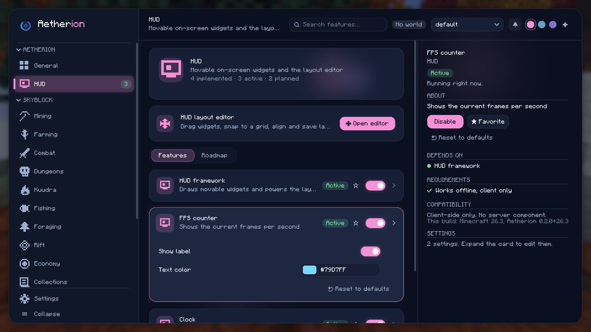

# Aetherion

A client-side Fabric mod for Hypixel SkyBlock with a custom, animated configuration interface (the
**Aurora** GUI), a registry-driven feature framework and an interactive HUD layout editor.



## Status: what is real and what is not

This is the **foundation milestone**. Be clear-eyed about it:

| Working today | Planned, not implemented |
|---|---|
| Aurora GUI: sidebar, header, search, cards, detail panel, modals, toasts, tooltips | Every SkyBlock gameplay module (mining, farming, combat, dungeons, economy, ...) |
| Typed settings: toggle, slider, dropdown, color picker, keybind | Hypixel API client and profile data |
| Feature framework: registry, dependencies, lifecycle, capability checks | |
| Profiles, favourites, import/export, reset, English and German | |
| HUD framework with three passive widgets (FPS, clock, coordinates) | |
| HUD layout editor: drag, grid snap, guides, anchors, scale, opacity, layers, presets, save slots | |
| Performance page with real measurements | |

The 32 planned features are listed in [`docs/ROADMAP.md`](docs/ROADMAP.md) and shown in the game as
*Planned* / *Needs review* entries. They **cannot be enabled**, and a test enforces that.

## Supported versions

| Minecraft | Jar | Verified |
|---|---|---|
| 26.2 | `aetherion-<version>+26.2.jar` | built, 62 unit tests, 47 runtime checks in a real client |
| 26.3 | `aetherion-<version>+26.3.jar` | built, 62 unit tests, 47 runtime checks in a real client |

Requires Java 25, Fabric Loader 0.19.5+, Fabric API and Fabric Language Kotlin. ModMenu is optional.
A jar for one Minecraft version will refuse to load on the other - they are separate builds on purpose.
See [`docs/TESTING.md`](docs/TESTING.md) for exactly what was and was not tested.

## Using it

| | |
|---|---|
| `/aetherion` | open the configuration screen |
| `/aetherion hud` | open the HUD layout editor |
| Right Shift | open the configuration screen from in-game (rebindable under General > Interface) |
| ModMenu | config button opens the same screen |

In the screen: `Ctrl+F` focuses search, `Tab` cycles controls, `Up/Down` select feature cards,
`Right/Left` expand/collapse, `Enter` toggles, `Esc` closes. In the HUD editor: drag, mouse wheel to
scale, arrow keys to nudge, `Tab` hides the toolbars, `Esc` leaves.

## Building

```bash
# one target
./gradlew build -Pmc_target=26.2     # or 26.3 (default is 26.3)

# both targets, with tests, jars and checksums collected in dist/
bash tools/build-all.sh
```

Jars are written to `build/libs/` as `aetherion-<version>+<minecraft>.jar`.

## Development

```bash
./gradlew test -Pmc_target=26.2                   # unit tests
./gradlew runClient -Pmc_target=26.3              # dev client
./gradlew runClient -Pmc_target=26.2 -Pdev_width=1280 -Pdev_height=720
```

Automated GUI verification drives a real client through the same input methods the game uses:

```bash
JAVA_TOOL_OPTIONS="-Daetherion.dev=gui"   ./gradlew runClient -Pmc_target=26.2   # 47 checks
JAVA_TOOL_OPTIONS="-Daetherion.dev=shots" ./gradlew runClient -Pmc_target=26.2   # screenshot tour
```

Results are written to `run/aetherion-dev-results.txt` and `run/screenshots/`. The harness is inert
unless that system property is set.

Regenerate generated assets:

```bash
python tools/gen_sprites.py       # anti-aliased rounded-rect, ring and glow sprites
python tools/gen_roadmap_md.py    # docs/ROADMAP.md from roadmap.json
```

## Documentation

- [`docs/ARCHITECTURE.md`](docs/ARCHITECTURE.md) - structure, version strategy, rendering, animation, config
- [`docs/ROADMAP.md`](docs/ROADMAP.md) - planned features with data source, complexity, API needs, rule assessment, acceptance criteria
- [`docs/TESTING.md`](docs/TESTING.md) - exact test results, measurements and known limitations
- [`CHANGELOG.md`](CHANGELOG.md)

## Rolling back

The previous state is preserved: `master` is untouched, and the commit it pointed to is tagged
`pre-aurora-rebuild` locally (`8256780`). Work lives on `feat/aurora-rebuild`. To abandon the rebuild,
delete that branch. Players upgrading from 0.1.0 keep a copy of their old config as
`config/aetherion.json.v1-backup`; the old file contained only empty placeholder categories, so nothing
of value is lost.

## License

MIT, see [`LICENSE`](LICENSE).
